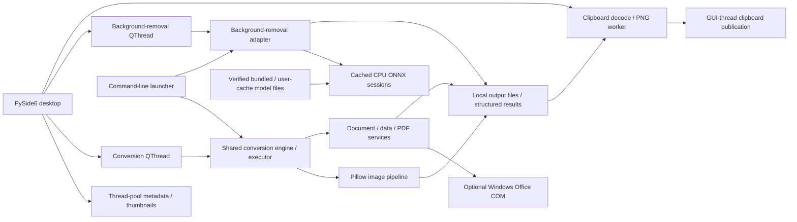

# Universal File Converter — technical and UI review

Review period: 18–19 October 2026, Africa/Tunis. Scope: the local source tree, installed Windows runtime, background-removal integration, tests and packaging. This report distinguishes source inspection, reproduced defects and supplied execution evidence. It is a technical review of this checkout, not a claim that every conversion or operating system has been certified.

The later [full GUI report](GUI_REPORT.html) expands the page/control inventory.
The [model continuation guide](BACKGROUND_MODELS.md) records the new readiness
command, guarded verification tool and latest **260 passed / 3 skipped** backend
result. Test/build figures below describe their original review checkpoint;
they do not imply the new source diagnostic command is in that earlier executable.

The subsequent [runtime optimization](RUNTIME_OPTIMIZATION.md) changes those
earlier resource defaults: two CPU threads, no dummy startup inference, selected
output only, bounded normal-conversion concurrency and batch-end session release.
Its measurements and latest tests take precedence over the earlier snapshot
below. The [separate training workflow](TRAINING_AND_OPTIMIZATION.md) is prepared
for reviewed data; no retraining has occurred.

## Assessment

The app is a useful local desktop converter with a command-line interface, a shared conversion engine, separate document/data/PDF services and a dedicated ONNX background-removal workspace. Its strongest architectural choices are reusable core services, structured conversion results, a model/view conversion queue, background workers for normal conversion and background removal, and explicit local model verification.

It is best described as a Windows desktop application with portable Python conversion components. Native Word, Excel and PowerPoint rendering requires Windows, Microsoft Office and `pywin32`. Several folder-opening actions also use Windows-only `os.startfile`. The README's broader platform and Python-version claims exceed the execution evidence available for this review.

The app is not yet ready for an unrestricted general release without addressing the output-safety and manifest-cleanup defects below. The new background-removal adapter has stronger output collision protection than the older general conversion workflows. Full-resolution clipboard integration is implemented and verified on Windows, and all four model profiles are installed and hash-verified locally. Fast and Balanced completed real-image checks. Quality/Portrait exceeded available RAM during guarded trials; the app now checks for at least 8 GiB free before initializing either large CPU model and explains the requirement. Their successful inference is not established on this machine. The verification section records the evidence and limits.

## Architecture and execution

| Layer | Actual responsibility and source |
| --- | --- |
| Launchers | [launch_converter.py](../launch_converter.py) starts the GUI without arguments; arguments select the CLI, except `--gui`. `main.py` is a compatibility entry point. Shortcut creation is a separate route. |
| Desktop shell | [main_window.py](../image_converter/ui/main_window.py) owns navigation, queue state, batch settings, result presentation and tool-dialog launchers. PySide6/Qt Widgets provides native desktop UI; there is no browser frontend or application server. |
| Queue | [queue_model.py](../image_converter/ui/queue_model.py) uses `QAbstractTableModel`, a `QTableView`, custom delegates and `QueueEntry` records. Metadata and thumbnails are analyzed by `QRunnable` tasks on the global `QThreadPool`. |
| General conversion | [conversion/engine.py](../image_converter/core/conversion/engine.py) routes by source extension and requested target, validates inputs, performs Pillow image conversion and returns `ConversionResult` records. `UniversalConverterEngine` aliases `ImageConverterEngine`. |
| Domain services | [documents](../image_converter/core/documents/engine.py), [data](../image_converter/core/data/engine.py), [presentations](../image_converter/core/presentations/engine.py), [rich_documents](../image_converter/core/rich_documents/engine.py), [pdf](../image_converter/core/pdf/tools.py), [metadata](../image_converter/core/metadata/engine.py) and [ocr](../image_converter/core/ocr/engine.py) contain the implementations. |
| Compatibility imports | Flat names such as `core/engine.py` and `core/document_engine.py` re-export the domain modules. These are wrappers, not competing implementations. Many existing callers still use them. |
| Background removal | [background_removal.py](../image_converter/core/background_removal.py) adapts the independently packaged [backgroundG](../backgroundG/src/bgremove/remover.py) library. It plans collision-free tasks, lazily initializes the backend and publishes cutouts/masks. |
| Platform and diagnostics | [COM helpers](../image_converter/core/platform/com_utils.py) initialize COM on each executing thread; [logging](../image_converter/core/observability/logging_config.py) configures console and rotating local log files. |

The normal GUI flow is: select/drop files → queue analysis → choose batch defaults or a row-specific target → build `(input, output, ConversionConfig)` tasks → `BatchConversionWorker` → engine `ThreadPoolExecutor` → domain converter → `ConversionResult` → queued Qt signals update rows and totals. The default executor size is now the smaller of two workers and the logical CPU count; explicit overrides remain supported. The CLI creates similar tasks and invokes the shared engine without the GUI.

A source-size snapshot counts 17 UI Python files/6,775 lines, 35 core files/5,821 lines and 16 background-library files/2,166 lines, including comments and blanks. Individual modules remain substantial: `components.py` has 1,428 lines, the conversion engine 1,338, `tool_dialogs.py` 1,104 and `main_window.py` 977. These counts explain the recommendation to split responsibilities and remove duplicated capability definitions; they are not a quality score.

`ConversionConfig` carries format, quality, resize, transparency, DPI, metadata, password, sheet, OCR and worker settings. `ConversionResult` carries success, paths, sizes, dimensions, elapsed time and an error/warning string. Results representing page/slide expansion expose only the first generated file; batch size statistics therefore do not represent the combined size of every side output.

Settings, queue contents and window geometry are held in memory. There is no implemented `QSettings` persistence, job database, crash recovery or saved-session format. Logs default to `%APPDATA%/UniversalFileConverter/logs/converter.log`, rotate at 5 MiB and keep three backups. Error logs can contain local filenames and paths.

## Conversion capability, by implemented route

The advertised output-format list is not an all-to-all conversion matrix. [UI compatibility menus](../image_converter/ui/components.py) also diverge from the engine in a few cases.

| Input | Implemented targets | Dependencies and practical limits |
| --- | --- | --- |
| Raster images | JPG, PNG, WebP, HEIC, BMP, TIFF, GIF, ICO, PDF; DOCX containing the image; TXT through OCR | Pillow; HEIC needs `pillow-heif`; image-to-TXT always invokes OCR. GIF/TIFF conversion does not implement a general animation/multipage preservation pipeline. EPS acceptance depends on Pillow's external decoding support. |
| PDF | PNG/JPG/WebP/BMP/TIFF page images, DOCX, TXT, CSV/XLSX table extraction | PyMuPDF; DOCX first tries `pdf2docx`, then Word COM. Text extraction can OCR pages lacking text. Table extraction needs actual detectable table structure; it is not scanned-table OCR. |
| DOCX | PDF, TXT, HTML, PNG/JPG/WebP, ODT, RTF | TXT/HTML use `python-docx`; layout rendering to PDF/images and ODT/RTF routes require Word COM. Legacy `.doc` is accepted but shares several DOCX-only parsers and is not consistently supported. |
| PPTX | PDF, TXT, HTML, PNG/JPG/WebP | Text/HTML use `python-pptx`; PDF/image rendering requires PowerPoint COM. |
| CSV | XLSX, PDF, JSON, HTML, TXT | pandas, openpyxl and ReportLab. CSV encoding fallback is implemented. PDF export currently keeps only the first 1,000 data rows by default, without a truncation warning. These are data exports, not workbook fidelity preservation. |
| XLSX / XLS | CSV, PDF, JSON, HTML | pandas/openpyxl for data; native PDF requires Excel COM. Legacy XLS needs a compatible pandas reader such as `xlrd`, absent from declared requirements. CSV uses the selected/first sheet; JSON/HTML can include all sheets. |
| ODT / RTF | TXT; PDF, DOCX and interconversion between ODT/RTF | Text extraction uses odfpy/striprtf; native conversions require Word COM. |
| TXT | PDF, DOCX, PPTX, RTF; HTML route exists but currently fails | Basic document generation rather than layout reconstruction. TXT-to-HTML has a reproduced missing-import defect. |
| Metadata cleaning | Images, PDF, DOCX, PPTX, XLSX/XLSM, ODT and stream-copy handling for several text formats | Removes selected metadata properties. It does not establish that every embedded identifier or document-content disclosure was removed. |

JSON and HTML are output formats, not normal input formats discovered by the launcher. PDF→PPTX, Word→PPTX and PPTX→DOCX appear in the current GUI compatibility menus but are explicitly rejected by the engine. PDF→DOCX accepts `enable_ocr`, but that method does not use the flag to provide a scanned-page OCR fallback. The password control is effective for supported PDF routes; encrypted Office packages are detected/rejected rather than decrypted by a general Office-password implementation.

Text decoding in several TXT/RTF paths uses UTF-8 with ignored errors. Generated text/table PDFs use ReportLab's standard styles, including Helvetica-family headings; the source does not establish embedded Unicode fonts or Arabic/right-to-left shaping. OCR defaults to English (`eng`); the core accepts a language argument, but the current GUI does not expose a language selector. Non-ASCII document fidelity therefore needs explicit fixtures rather than assuming it follows from UTF-8 input support.

## UI walkthrough, page by page

### Shared window and navigation

The default window is 1380×860 with a minimum of 1120×700. A horizontal header contains the app icon, “LOCAL FILE WORKSPACE”/application name, four exclusive navigation buttons and an “ON-DEVICE · NO UPLOADS” badge. There is no visible sidebar rail: `nav_rail = None`; the old `StatsWidget` is retained hidden for compatibility.

| Element | Behavior and state |
| --- | --- |
| Convert / Image Tools / PDF Tools / Remove Background | Switch the `QStackedWidget`; checked styling identifies the current page. Switching pages does not itself discard queue data. |
| Add files / Add folder | Visible on Convert only. File picker supports multiple files; folder selection scans recursively and filters supported extensions. |
| Window drop overlay | A full-window “Drop to add files” overlay appears while local files hover. Convert drops add to the main queue; the background page handles its own image queue. Folder scanning is synchronous, so a very large tree can stall interaction. |
| Keyboard | `Ctrl+O` adds files, `Ctrl+Shift+O` adds a folder, `Ctrl+Return` starts conversion/background removal, `Escape` requests cancellation; Delete removes selected queue entries. Header/settings/queue/actions have explicit tab ordering. |
| Close during conversion/removal | Requests cancellation and ignores the close event; the user closes again after the conversion/removal worker finishes. No forced thread termination is used. |

The dark theme is centralized in [theme.py](../image_converter/ui/theme.py): navy surfaces, violet actions, cyan focus, green success and pink error states. Accessible names/descriptions and a [token contrast audit](../image_converter/ui/contrast.py) exist. These are useful foundations; they do not replace a screen-reader, high-DPI or keyboard-only user test. There is no visible light/dark theme selector, localization control or responsive single-column layout for small displays.

From the layout review, the background page provides the clearest complete workflow: input, original, result, settings and actions share one workspace. Convert is efficient for mixed queues, although selecting a file replaces batch settings and requires a back action to resume configuration. Image/PDF landing cards offer a readable introduction but add a launch step before the modal tools; frequent users can reach several tools directly from queue context menus. The larger UX inconsistency is behavioral: the main conversion/background pages use workers, while heavyweight modal tools can pause the interface. These are design judgments from source/screenshots, not measured user-study results.

Current offscreen captures support the layout review below. The new Copy image button fits beside Result at default and minimum window sizes; advanced settings remain reachable by scrolling at the minimum size. The linked background-result/minimum screenshots show a completed Fast job followed by successful Copy image. The Quality-selected screenshot shows the final 8 GiB RAM hint before processing, with an empty result canvas; it does not imply Quality inference succeeded. The separate advanced-controls capture displays an earlier real output assigned for static layout inspection; its “Queued” row/footer is not completion evidence. Offscreen modal backgrounds can appear black/transparent and are not evidence of a native-window rendering defect.

| View | Captures |
| --- | --- |
| Convert | [Empty state](../scratch/ui-report/01-convert-empty.png), [batch settings](../scratch/ui-report/02-convert-batch-settings.png), [file inspector](../scratch/ui-report/03-convert-file-inspector.png) |
| Image Tools | [Launch page](../scratch/ui-report/04-image-tools.png), [compressor dialog](../scratch/ui-report/14-compress-images-dialog.png) |
| PDF Tools | [Merge page](../scratch/ui-report/05-pdf-tools-merge.png), [Split](../scratch/ui-report/06-pdf-tools-split.png), [Organize](../scratch/ui-report/06-pdf-tools-organize.png), [Compress](../scratch/ui-report/06-pdf-tools-compress.png) |
| PDF dialogs | [Merge](../scratch/ui-report/10-merge-dialog.png), [Split](../scratch/ui-report/11-split-dialog.png), [Organize](../scratch/ui-report/12-organize-dialog.png), [Compress](../scratch/ui-report/13-compress-pdf-dialog.png) |
| Remove Background | [Completed job / Copy image](../scratch/background-gui-smoke/background-page.png), [advanced controls](../scratch/ui-report/08-background-advanced.png), [completed job at minimum window](../scratch/background-gui-smoke/background-page-minimum.png), [Quality RAM requirement before processing](../scratch/background-gui-smoke/quality-memory-requirement.png) |

### Convert page

The page uses a non-collapsible horizontal splitter: conversion queue at left and a 340–420 px inspector/settings panel at right. The conversion status/action dock belongs to this page, not every page.

| Element | Purpose and exact interaction |
| --- | --- |
| Conversion queue / file count | Count updates with additions/removals. Empty state offers “Choose files” and “Choose folder”; a populated queue has a compact “Drop more files…” bar and “Add more”. Duplicate resolved paths are ignored. |
| Remove / Clear queue / Undo | Remove requires selection; Clear requires queue contents. Toolbar removal/addition and settings controls disable during conversion, but the table/context menu and some keyboard entry points remain active, as detailed in the findings. Removal retains an undo action for the last removal operation. These actions remove queue entries, not source files. |
| Status column | Queued, Converting, Done, Warning, Failed and Cancelled states. Failure details are available through tooltips; failed rows can be retried. All tasks receive a start signal before the executor starts, so “Converting” should not be read as an exact count of simultaneously executing files. |
| Preview column | Small image or PDF thumbnail, loaded asynchronously; other formats use document information rather than full rendered pages. |
| File column | Filename with secondary dimensions/page/word/row information. Full path is exposed in the tooltip. Multi-selection is supported. |
| Convert to column | Per-row compatible-format editor. Overrides let a mixed queue retain different targets. |
| Est. size column | Heuristic output estimate before conversion; actual size after conversion. The estimate is not a trial encoding or guaranteed bound. |
| Queue context menu | Open location, copy full path, inspect, failed-row retry, PDF split/organize/compress, selected-image compression/background removal, merge selected files and remove from queue. Tool entries depend on selection type. |
| Inspector | Selecting a row replaces batch settings with a file inspector; “Back to batch settings” clears selection and returns. Images/PDF first pages render visually; documents/data show structured summaries. Name, details, type, size and metadata state appear below, with Open folder and Copy path. These copy a path, not image pixels. |
| Bottom dock | Queue count/input size/estimated output when ready; progress and Cancel conversion while busy; success/failure totals, Open folder and Convert more after completion. Completed outputs remain after cancellation. |

The batch settings panel has four tabs:

| Tab / controls | Behavior |
| --- | --- |
| Format: intent presets | Email-friendly chooses the first available of JPG/WebP/PDF and quality 65; Web-optimized prefers WebP/JPG/HTML and 80; Archive quality prefers PNG/TIFF/PDF and 100. These are convenience settings, not measured suitability guarantees. |
| Format: categorized target menu | Normally shows targets common to the queue; mixed queues without a common target use per-file settings. The actual mixed-queue label is the raw `PER_FILE` identifier; replacing it with “Per file” would improve clarity. Category labels are disabled/non-selectable. |
| Format: quality / lossless | Quality 1–100 defaults to 90, visible for JPG/WebP/HEIC; WebP exposes lossless. Estimated size is shown beside the slider. |
| Format: destination | Defaults to each original's folder. Custom folder enables a path field and Browse. Same-format output receives `_converted` or `_clean` when needed to avoid directly targeting its own source; broader collisions remain a reported defect. |
| Resize | Original size, percentage (5–500%), custom dimensions or fit within maximum bounds; width/height 1–10,000 px and aspect-ratio option. Fit-box only downscales. Render DPI 50–600 defaults to 150. Alpha background color applies when flattening to JPEG/BMP. The tab is hidden without image inputs, which also hides the relevant DPI setting in a PDF-only image-rendering workflow. |
| Documents | Excel sheet name; OCR fallback checkbox; masked password entry. The tab is hidden without document/data inputs. Engine limitations still apply even when a field is visible. |
| Metadata | Strip metadata, preserve EXIF and auto-orient controls. EXIF preservation/auto-orientation default on. The privacy label's broad promise exceeds the selective cleaning actually implemented. |

Queue background analysis avoids much initial work on the GUI thread, but clicking the detailed inspector performs synchronous metadata parsing/rendering. Large documents can still pause the UI there. No built-in output gallery, persistent conversion history or exportable job log is visible.

### Image Tools page and compressor

The page itself contains an “IMAGE WORKSPACE” heading, a description, a centered compression card, three feature bullets and “Open image compressor”. Actual controls are in a modal dialog.

| Compressor element | Behavior |
| --- | --- |
| Image list, Add images, Remove, Clear | Builds a multiselect batch. It can be prepopulated from conversion-queue selections. |
| Output format | WebP, JPG, PNG or Keep original format. |
| Quality | Slider 1–100; initial value 75. PNG remains lossless; quality semantics vary by target encoder. |
| Fit within | Enabled initially; maximum-width/height values 64–20,000 px, initially 1920×1920. The same-format metadata-cleaning defect below can bypass the selected resize. |
| Strip metadata | Enabled initially; requests cleaning of compressed copies. |
| Output folder / Browse | Blank uses each image's folder. Unique `_compressed` filenames are generated. |
| Result/status and Compress Images / Cancel | Reports batch success/failure and savings, then offers to open the output folder. Processing is synchronous; Cancel dismisses the dialog while idle rather than interrupting an active background job. |

Two existing behaviors can discard requested changes. First, the shared engine treats same-format metadata cleaning as an early-return route, skipping resize/quality settings; a 256×128 PNG requested within 64×64 with cleaning enabled remained 256×128 in a scratch reproduction. Second, if same-format compression produces a larger file, the dialog copies the original to the destination, potentially restoring metadata or discarding transformations. These behaviors merit correction before presenting all selected transformations as guaranteed.

### PDF Tools page and dialogs

The PDF page contains its heading, explanatory subtitle and four exclusive buttons: Merge, Split, Organize and Compress. Each selects an explanatory card with a launch button; editing occurs in a separate modal workspace.

| Workspace | Elements and behavior |
| --- | --- |
| Merge | File table accepts PDFs/images; Add files, Move Up/Down, Remove, Clear; output-PDF path and Browse; file count/status; Merge to PDF and Cancel. Requires at least two files and an output path. Selection ordering determines output ordering. The current dialog offers explicit move buttons; its marketing “drag-friendly ordering” should not imply a verified drag-reordering feature. |
| Split | Choose PDF; filename/page count/size; single-page radio default, every-N-pages radio with N 2–500, or custom ranges such as `1-3, 5, 7-end`; output-folder picker; Split PDF and Cancel. Range parsing validates bounds before processing. |
| Organize | Choose PDF; 100×140 thumbnail icon grid; Move Left/Right, Rotate 90°, Duplicate, Delete; page count; Save Reorganized PDF and Cancel. Changes are staged as page instructions and written when saving. |
| Compress | Choose PDF and size; Balanced default (150 DPI/75 quality), Maximum (100 DPI/55 quality) or Lossless stream-deflation profile; result banner; Compress PDF, save-file picker and Cancel. Reports no reduction when the original is already optimal and copies the original rather than inflating it. |

PDF merge/compression use temporary output plus replacement in the core. Other PDF utility save paths are less uniform. These dialogs perform work synchronously, including page-thumbnail loading: large PDFs can freeze the window and do not offer the conversion queue's cooperative cancellation/progress behavior.

### Remove Background page

The page has its own image queue, original/result comparison, scrollable settings and action footer. It is separate from Image Tools as requested.

| Element | Behavior and states |
| --- | --- |
| Add images / Use conversion queue | Adds supported local images or imports selected/all supported images from Convert. Local file/folder drops are accepted; unsupported files are skipped. |
| Image queue / count | Extended selection; per-image Queued, Done, Failed or Cancelled text. Tooltips show the destination or failure reason. Remove selected and Clear edit only queue state. |
| Original / Result canvases | Side-by-side previews; checkerboard makes transparency visible. Previews use pooled `QImageReader` work bounded to 1200×900, reject excessive dimensions, and ignore stale completion signals using generation IDs. Reader handles are released before completion signals so Windows file replacement/deletion is not held up by a finished preview. Full saved images retain their source resolution unless cropped. |
| Model | Fast default, Balanced, Quality and Portrait. Selection is a processing profile; actual model files must exist and verify locally. Quality/Portrait show an explicit requirement for at least 8 GiB free RAM; Fast/Balanced show the local-CPU/default-model hint. Model names are not measured quality rankings for every image. |
| Output / Save to | Transparent PNG or lossless WebP; blank destination uses source folders. Names use `_nobg`, numeric disambiguation and an optional `_mask.png` pair. |
| Also save mask / Keep EXIF metadata | Optional grayscale alpha export and EXIF retention. Default excludes EXIF; the backend retains color-profile information where available. |
| Advanced toggle | Shows/hides feather (0–20), edge shift (−5 to +5), two-pass refinement, crop-to-subject, padding (0–2000 px), solid background color and custom model-folder picker. Blank background means transparency. |
| Status/progress | Indeterminate during initial loading, then per-file completion progress; final saved/failed count includes an error summary. There is no intra-inference percentage. |
| Remove background / Cancel / Open output folder | Start requires queued images; queue/settings editing is disabled while busy. Cancel requests a safe stop; output-folder action enables after a successful save. Existing files and originals are protected by the adapter. |
| Copy image | Button beside the Result caption, right-click action on the result canvas, and `Ctrl+C` while the image queue/result has focus. It copies the currently selected successful saved result at full resolution. Disabled with no result, missing/failed/unreadable output, or during preparation; label becomes “Copying…”. Normal text-field copying keeps its usual behavior. |

The page permits JPEG, PNG, WebP, BMP and TIFF up to 25 MiB/120 megapixels; animated/multipage inputs are rejected. HEIC/GIF are intentionally outside this tool's input set even though the general converter accepts them. Clipboard pasting depends on the destination application: image-aware editors can accept pixel data, Explorer-like destinations can accept file references, and plain-text fields cannot display an image. A paste destination may flatten transparency or choose a different clipboard representation. In particular, older apps choosing legacy DIB can discard alpha and display hidden source colors/background; importing the saved PNG into a transparency-aware app or using a PNG-aware paste destination avoids that legacy path.

[image_clipboard.py](../image_converter/ui/image_clipboard.py) reads the actual saved PNG/WebP, decodes the full-resolution image and generates PNG bytes in a worker on the global Qt thread pool. It does not copy the scaled preview or checkerboard. Clipboard publication happens on the GUI thread with `image/png`, native `QImage`, a local-file URL and the registered Windows PNG format. Request generations, selected-output checks and file identity/size/mtime signatures discard stale work after selection changes, reruns or file replacement. Clipboard contents change only after an explicit successful copy action. File-reference pastes require the saved file to remain available.

Qt documents storing multiple representations in one MIME object and exposing Windows custom formats through `application/x-qt-windows-mime`. These mechanisms support the app's combined image/file payloads. [Qt 6.11 QMimeData documentation](https://doc.qt.io/qt-6.11/qmimedata.html#platform-specific-mime-types).

## Background-removal technology and resource behavior

The adapter initializes `bgremove.Remover` lazily and selects `device="cpu"`. The underlying library supports other ONNX providers, but this app does not expose GPU selection. The measured ONNX runtime advertises Azure and CPU providers; CUDA/DirectML providers are not installed in this environment. An explicit model-folder setting or `BGREMOVE_MODEL_DIR` is authoritative; otherwise it checks the frozen bundle and repository model folder for the selected profile, then delegates to the user cache. A bundle containing Fast does not hide a different profile installed in the cache.

| Profile | Registry model | Model input | Model file size |
| --- | --- | --- | --- |
| Fast | U²-NetP | 320×320 | 4,574,861 bytes |
| Balanced | IS-Net general use | 1024×1024 | 178,648,008 bytes |
| Quality | BiRefNet general | 1024×1024 | 972,666,916 bytes |
| Portrait | BiRefNet portrait | 1024×1024 | 972,666,916 bytes |

Files total 2,128,556,701 bytes, approximately 1.98 GiB. The measured Windows cache is `C:\Users\ahmed\AppData\Local\bgremove\bgremove\Cache`, outside the source repository. [models.json](../backgroundG/src/bgremove/models.json) pins filenames, SHA-256 values, sizes, tensor normalization and provenance. Model verification hashes the complete file on initialization. [Explicit installation](../backgroundG/src/bgremove/model_install.py) restricts HTTPS hosts/redirects, checks expected size and digest, stages downloads and publishes atomically; inference does not download models automatically. Registry provenance and redistribution notices should accompany distributed weights; this report does not independently certify upstream licensing.

Processing is: decode/auto-orient and normalize color → resize RGB to model input → model-specific mean/std normalization and NCHW tensor → ONNX inference → validate/activate/rescale mask → optional second inference on a subject crop → small-region cleanup and optional edge shift/feather → compose RGBA/crop/background → stage exports → publish. The default cleanup can remove small disconnected components. Optional matting exists in the library but requires additional dependencies and is not exposed or bundled by this application.

Each new engine now initializes and validates its session without dummy
inferences. The process-global cache identifies engines by model
path/device/thread/config; CPU session execution is locked per engine. The app
handles background-removal images serially, reuses a session within the batch
and releases cache ownership in batch cleanup. A single-image service call also
cleans up afterward. Switching profiles drops idle previous-model ownership
before allocating a replacement; active external caller references remain valid.
Python clients can explicitly call `release_engine_cache()`. The desktop has no
separate manual unload button because it releases sessions automatically.

Registered models of at least 500,000,000 bytes selected for CPU execution now require 8 GiB available physical RAM before `SessionOptions`/`InferenceSession` allocation. This covers Quality and Portrait, leaves Fast/Balanced unchanged and runs after releasing the previous idle cache entry. Reusing an already-warm engine does not reinitialize it. A failed preflight reports available GiB and suggests closing memory-heavy apps or using Fast/Balanced. Available RAM was 5.02 GiB at the final model-file verification, below that threshold. The preflight is a startup headroom check, not a continuous monitor or hard memory limit; passing it does not guarantee every model/image will complete. Production ONNX graph optimizations remain enabled. ONNX now defaults to two CPU threads with idle spinning disabled. File size alone does not predict RAM use, and no general latency/segmentation-quality benchmark was established.

Cancellation is cooperative: current ONNX inference and session warmup finish before control returns. The adapter checks cancellation before processing and before output publication, so cancelled work need not save a result. General conversion similarly cannot forcibly interrupt a current Office/native operation; executor shutdown waits for running tasks. Worker threads keep interfaces responsive where used, but do not isolate parser crashes or enforce hard timeouts.

## Validation, safety and output behavior

[Input validation](../image_converter/core/safety/security.py) checks existence, nonzero size, a default 500 MiB limit, selected signatures and ZIP-container bounds. ZIP-based documents are limited to 50,000 entries and 500 MiB total expanded bytes; suspicious ratios above 100:1 are rejected when expanded content exceeds 10 MiB. These checks reduce common mistakes and resource abuse; they are not a sandbox. Some formats lack signature enforcement, and preview/metadata routes do not consistently pass through conversion validation first.

General image saves use a same-directory temporary file plus `os.replace`, which avoids leaving a partially written final file but permits replacing an existing destination. Some document/data utilities write directly. The generic verifier establishes only that the reported output exists and is nonempty, not that every page is present or the file can be decoded correctly. Empty text extraction is treated as failure even when an empty text result could be legitimate.

Background removal additionally reserves all batch inputs/outputs, disambiguates names, rejects preexisting targets and uses `os.link` for exclusive publication with rollback of its own published output/mask if the pair fails. This depends on a destination filesystem supporting hard links; FAT/exFAT or some network destinations can fail and need a supported fallback policy. It avoids clobbering files on those failures.

## Runtime, dependencies and packaging

The measured app environment is Windows 11 build 26200; 64-bit Python 3.14.2; six physical/twelve logical CPU cores; 15.42 GiB RAM, with approximately 5.76 GiB available at capture. The project virtual environment is the relevant interpreter; the machine's default `python` has different package versions.

| Component | Installed project-environment version |
| --- | --- |
| PySide6 Essentials / Pillow / pillow-heif | 6.11.2 / 12.3.0 / 1.7.0 |
| PyMuPDF / pdf2docx / ReportLab | 1.28.2 / 0.5.13 / 5.0.1 |
| pandas / openpyxl | 2.3.3 / 3.1.5 |
| python-docx / python-pptx | 1.2.0 / 1.0.2 |
| NumPy / OpenCV headless / ONNX Runtime | 2.4.2 / 5.0.0.93 / 1.25.0 |
| local-bgremove / pytesseract / PyInstaller | 0.2.0 / 0.3.13 / 6.22.3 |
| Background CLI Typer / shellingham | 0.27.3 / 1.5.4 |

[requirements.txt](../image_converter/requirements.txt) uses broad minimum versions and mixes runtime, testing and build dependencies; there is no lockfile establishing a reproducible environment. [Background requirements](../image_converter/requirements-background.txt) add the local package, which requires Python 3.11+. `pywin32` is documented as optional but omitted from the base dependency file; installed Office and the Tesseract executable/language data are external requirements, not supplied by their Python wrappers. The reviewed evidence establishes this Windows/Python 3.14 environment, not every README-listed version/platform.

[The PyInstaller spec](../universal_file_converter.spec) collects Qt assets, codecs, native ONNX/OpenCV libraries, package metadata and notices, excludes heavyweight training frameworks and matting, and embeds only verified Fast weights. Larger models remain external cached files. It performs no model downloads during the build. The current verified one-file Windows build completed with PyInstaller 6.22.3 at 251,228,220 bytes (about 239.6 MiB), including clipboard copying, bounded model-cache ownership, RAM preflight and the installed background CLI dependencies. It passed real Fast CPU inference offline from an isolated working folder. The spec uses `console=False`, so source CLI execution is preferable for ordinary terminal diagnostics. No signing/update pipeline is implemented in the inspected build configuration.

## Verification evidence and limits

| Check | Evidence / status |
| --- | --- |
| Current focused application suite | 140 passed, one deselected in 8.37 seconds, including the clipboard and model-hint changes. The deselected route involves Office DOCX-to-PDF. This is targeted application regression, not a full-application run. |
| Current backgroundG library suite | 240 passed, three skipped in 3.55 seconds, including cache ownership and memory preflight. This is separate from the 140 focused application tests. |
| Previous real-image smoke | GUI and CLI Fast inference passed; 770×595 RGBA output, alpha range 0–255, original unchanged. This verifies operation/transparency, not general segmentation quality. |
| Current real GUI / Copy image smoke | Passed after a real Fast removal: 770×595 RGBA output, alpha 0–255 and source SHA-256 unchanged. Asynchronous Copy image published an image and PNG data to `QClipboard` at full 770 px width; status became “Copied image. Paste with Ctrl+V.” [Default layout](../scratch/background-gui-smoke/background-page.png), [minimum layout](../scratch/background-gui-smoke/background-page-minimum.png). |
| Current frozen build | PyInstaller 6.22.3 exited successfully; 251,228,220 bytes with the final clipboard/cache/preflight changes. The executable passed real Fast CPU inference from a separate working folder with `BGREMOVE_OFFLINE=1` and `PYTHONPATH`, `PYTHONHOME` and `BGREMOVE_MODEL_DIR` removed. PNG output was 770×595 RGBA with alpha 0–255; mask was written and source SHA-256 unchanged. [Verification script](../scratch/verify_background_executable.py), [output](../scratch/background-executable-smoke/horse-1792366186066605200.png). |
| Frozen Quality cache / preflight | Passed the intended refusal check: the final executable ran offline from an isolated folder, discovered and verified the default-cache Quality weights without an explicit model directory, and exited 1 with “at least 8 GiB of free RAM” / 5.2 GiB available / choose Fast or Balanced. It created no output/mask and preserved the source SHA-256. Wall time 14.828 s; peak interpreter RSS 152.6 MiB; minimum available system RAM 5.064 GiB; the independent test guard did not trigger. No Quality inference was attempted. [Evidence](../scratch/background-frozen-quality-preflight/1792366301605442200/result.json). |
| Full application suite | Earlier run interrupted by Office COM errors; no complete green full-suite result is claimed. Test collection itself probes Word in [conftest.py](../image_converter/tests/conftest.py), so even collection can invoke Office. |
| Review reproductions | A tiny real PDF table plus disposable scratch manifest reproduced deletion outside the output folder. TXT→HTML reproduced `NameError: html is not defined`. Same-format PNG cleaning ignored requested 64×64 maximum bounds and retained 256×128 dimensions. A two-task image batch following the GUI's current naming rules replaced another queued JPEG source with the PNG conversion while both tasks reported success. Fixture: [scratch/technical-report-audit-8wcmskh6](../scratch/technical-report-audit-8wcmskh6). Only disposable files created for these checks were changed. |
| Clipboard coverage | Fourteen added clipboard tests are included in the 140 application passes: PNG/WebP 1800×1250 pixel/alpha fidelity, file URLs, invalid/missing/failed outputs, keyboard scope, stale selection/rerun/replacement races, worker responsiveness and GUI publication. They are a subset, not an additional total. |
| Model-cache ownership coverage | Five cases included in the 240 backend passes cover same-key reuse, release before replacement allocation, externally active engine validity across switches, failed initialization cleanup and strict-provider failure preserving a ready session. These use fake engines to validate ownership without allocating large models. [Tests](../backgroundG/tests/test_engine_cache.py). |
| RAM preflight coverage | Six cases included in the 240 backend passes cover Quality/Portrait rejection before ONNX allocation, unchanged Fast/Balanced behavior, the exact headroom boundary and release of the idle cache before the check. Tests use fake sessions; they do not establish successful large-model inference. [Tests](../backgroundG/tests/test_engine_memory.py). |
| Native Windows clipboard smoke | Passed; actual clipboard exposed PNG/image/png, `CF_DIBV5`, `CF_DIB` and `CF_HDROP`. PNG decoded to the exact 1800×1250 RGBA image with a half-transparent test pixel `(240,30,50,127)` and fully transparent surrounding pixels. File-drop data pointed to the saved cutout. [Evidence JSON](../scratch/clipboard-smoke/report.json). This verifies published formats, not acceptance by every external application. |
| Legacy DIB interoperability probe | **Local encoder test:** Qt 6.11.2 discarded alpha without compositing: `(23,91,177,0)` became opaque RGB `(23,91,177)`. [Probe evidence](../scratch/clipboard-dib-smoke/report.json). **Code inspection:** Qt's Windows MIME converter routes `CF_DIB` through `writeDib`; the BMP/DIB writer emits RGB without alpha. [Qt 6.11 Windows converter](https://github.com/qt/qtbase/blob/6.11/src/plugins/platforms/windows/qwindowsmimeregistry.cpp#L839-L864), [Qt 6.11 BMP/DIB writer](https://github.com/qt/qtbase/blob/6.11/src/gui/image/qbmphandler.cpp#L544-L622). Together these support the inference that a legacy DIB-only target can reveal hidden source colors. A later native clipboard read was denied by Windows, so the pixel values are encoder-test evidence rather than a new native DIB measurement; the earlier native-format/PNG smoke above remains separate evidence. |
| Current UI captures | All four pages and five tool dialogs captured; default/minimum-size background layouts and the Copy image action visually inspected. [Capture directory](../scratch/ui-report). These are offscreen layout checks, not a substitute for interactive accessibility/paste testing. |
| Balanced model | Installed and hash-verified in the user cache. Real-image strict CPU smoke passed on the 770×595 horse image with two ONNX threads: 4.076 s initialization/warmup including two dummy runs, 1.680 s actual inference, 1.770 s removal and 6.869 s full process. Output and mask existed; RGBA alpha spanned 0–255, mask 0–1, source SHA-256 unchanged. Peak interpreter RSS was 1.425 GiB (1.429 GiB process tree); available system RAM stayed above 4.282 GiB. Neither the 180 s test timeout nor sustained-low-memory guard triggered. [Result](../scratch/model-smoke/balanced/result.json), [monitor](../scratch/model-smoke/balanced/monitor.json). |
| Additional model installation | Balanced, Quality and Portrait were completely downloaded, matched their pinned sizes/SHA-256 values, atomically published and verified through the registry in the default user cache. New weight files total 2,123,981,840 bytes; existing Fast brings the four-file total to approximately 1.98 GiB. |
| Quality operational check | Before the new preflight, the default ONNX configuration did not complete warmup under observed available RAM. The isolated test was terminated by its low-memory guard after 37.81 s: peak interpreter RSS 5.837 GiB (5.840 GiB process tree), minimum available system RAM approximately 1 MiB. No completed real-image inference or cutout/mask was produced. [Monitor](../scratch/model-smoke/quality/monitor.json), [log](../scratch/model-smoke/quality/stdout.log). Installation alone does not establish runtime usability. |
| Portrait operational check | Before the new preflight, default-configuration warmup was also terminated by the low-memory guard after 37.36 s: peak interpreter RSS 6.887 GiB (6.891 GiB process tree), minimum available RAM 89.81 MiB from a 6.492 GiB available baseline. No completed real-image inference or cutout/mask was produced. [Monitor](../scratch/model-smoke/portrait/monitor.json), [log](../scratch/model-smoke/portrait/stdout.log). |
| Lower-memory Quality experiment | One scratch-only trial disabled graph optimizations, CPU arena, memory patterns and prepacking. Session creation succeeded in 23.263 s at about 1.062 GiB RSS, but the first dummy inference reached 5.314 GiB RSS and the stricter 800 MiB available-RAM guard stopped it at 60.57 s before completion. [Monitor](../scratch/model-smoke-lean/quality/monitor.json), [log](../scratch/model-smoke-lean/quality/stdout.log). This configuration was not applied to production and no Portrait trial was run with it. |

The repository has tests for engine routes, formats, concurrency, security helpers, metadata, OCR, COM behavior, CLI and UI, plus a separate backgroundG suite. Test presence alone does not show branch coverage or prove current success. Cached pytest failures were not treated as new findings.

The additional-model smoke measurements use separate CPU processes with two ONNX threads and validation-only time/memory guards. The normal app now uses two ONNX threads and applies the large-model startup preflight, but has no equivalent continuous process-kill guard; these measurements are operational checks rather than default-UI benchmarks or segmentation-quality scores.

## Prioritized findings and next work

“Release blocker” below is this review's recommended distribution priority, not a claim that the entire application fails in normal use. These preexisting findings were documented rather than silently changing unrelated features.

| Priority | Confirmed issue and consequence | Recommended action |
| --- | --- | --- |
| P1 — before broad distribution | PDF→CSV table cleanup trusts names in an existing `.<stem>_tables_manifest.json`, joins them to the output parent and deletes matching files. This requires a preexisting/tampered companion manifest. A scratch manifest containing `../sentinel.txt` deleted a disposable file outside the export folder. See [documents/engine.py](../image_converter/core/documents/engine.py). | Validate manifest structure and allow only tool-generated basenames resolved inside the output folder; reserve/protect inputs and reject symlink escapes. Add a targeted regression for this reproduced condition. |
| P1 — before broad distribution | General GUI task planning protects only each task's own input. With `photo.jpg` and `photo.png` both targeting JPG, it plans `photo_converted.jpg` and `photo.jpg`; a disposable two-task reproduction changed the queued JPEG source while both tasks reported success. Other same-stem inputs/custom folders can also map to one destination and race. See [main_window.py](../image_converter/ui/main_window.py) and [conversion engine](../image_converter/core/conversion/engine.py). | Centralize batch planning, reserve every input/output and define explicit overwrite/unique-name behavior across GUI and CLI, following the background-removal adapter. |
| P1 — privacy / transformation behavior | “Strip all metadata” overstates selective sanitization. RTF is copied unchanged as a text stream; same-format cleaning bypasses resize/quality; same-format compression may restore the original after cleaning/resize if its result is larger. | Tighten user-facing claims, implement format-specific RTF cleaning or declare its limits, combine image transforms/cleaning in one pipeline and never restore the original when requested transformations must be preserved. |
| P2 — functional defects | TXT→HTML calls unimported `html.escape` and fails. The image→DOCX malformed-DPI exception references undefined `img_p`, causing a secondary error instead of fallback. | Add the import, correct the variable and verify those branches with small fixtures. |
| P2 — silent CSV truncation | CSV→PDF defaults to `max_rows=1000`, slices larger data frames and returns a successful output without warning. The orchestrator does not override that default. See [data/engine.py](../image_converter/core/data/engine.py). | Export every row by default, or make a row limit explicit in the UI/CLI and include a visible truncation warning and source/export row counts in the result. |
| P2 — capability mismatch | UI offers PDF→PPTX, Word→PPTX and PPTX→DOCX although the engine rejects them; `.doc`/`.xls`, Office-password and PDF→DOCX OCR behavior are more limited than visible controls suggest. | Generate UI/CLI capability menus from a shared route/dependency registry; expose unavailable dependencies and unsupported branches before starting a batch. |
| P2 — queue busy-state integrity | During conversion, target cells remain editable and context-menu removal directly mutates the model; Ctrl+O/Ctrl+Shift+O can also add rows despite disabled toolbar buttons. Worker completions still map stored row indices, so removal can shift result/status updates onto a different row. | Enforce busy state at model/command entry points, disable mutating table/context actions and map tasks/results by stable entry IDs rather than mutable row numbers. |
| P2 — responsiveness | Tool dialogs, detailed inspector, PDF thumbnail loading and directory enumeration run synchronously; Office work has no hard timeout. | Move these operations into cancellable workers; consider subprocess isolation for Office and heavyweight parsers to permit timeouts/crash containment. |
| P2 — remaining resource limits | Idle multi-model retention was fixed and large CPU models now require 8 GiB free RAM before initialization. This preflight does not continuously enforce a memory ceiling. Guarded trials showed Quality/Portrait can consume several GiB during warmup; successful real inference remains unverified here. General conversion now defaults to at most two concurrent tasks and cannot overlap a background-removal batch in the GUI; previews bypass some core safety checks. | Keep the bounded cache/preflight and visible guidance; consider isolated worker processes and ongoing resource controls, validate before previewing and benchmark representative files on a machine with sufficient headroom. |
| P2 — clipboard interoperability constraint | Qt's legacy DIB representation drops alpha without compositing; older apps selecting it can show hidden source colors. PNG remains the verified transparency-preserving representation. | Explain destination-format limits; recommend saved-PNG import/PNG-aware paste. An explicit optional flattened-background copy mode could support older targets without promising transparent paste in every app. |
| P2 — build controls | `build_executable.py` parses `--onedir`, `--onefile` and `--console` but does not apply them; the spec always creates its configured windowed one-file output. | Implement the advertised switches or remove them; produce a tested console diagnostic build when needed. |
| P3 — maintainability | Compatibility re-exports, duplicated format lists, large GUI modules, mixed dev/runtime requirements and unpinned dependencies increase drift. Output verification and multiple-output result modeling are inconsistent. | Introduce a shared capability table, typed result manifest for all generated files, explicit public wrapper exports, split UI components and locked runtime/build environments. |
| P3 — product completion | No settings/session persistence, output history, model-memory indicator, in-app model installer, or broad platform/accessibility test evidence. A mixed queue exposes the internal `PER_FILE` label; hiding the Resize tab for PDF-only queues also hides render DPI. | Use a plain “Per file” label, show controls according to the operation rather than only source type, prioritize saved preferences and clear model availability/resource information, then verify keyboard, assistive technology, scaling and supported operating systems. |

The highest-value next engineering work is a unified safe output planner and corrected cleanup/privacy behavior. After that, shared capability discovery and worker-based tool dialogs would improve both correctness and day-to-day usability without requiring a rewrite or a network-service architecture.
